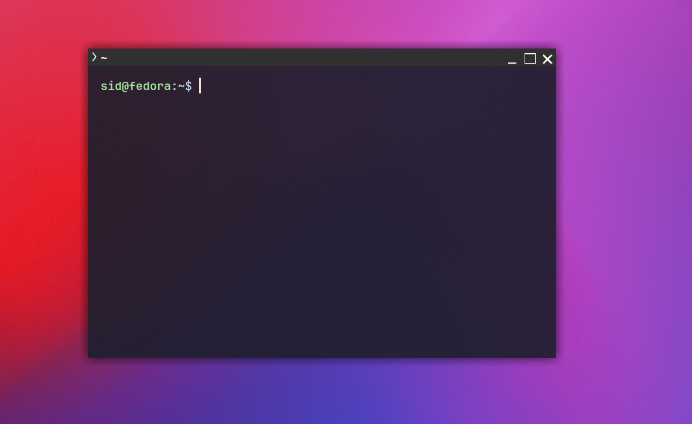
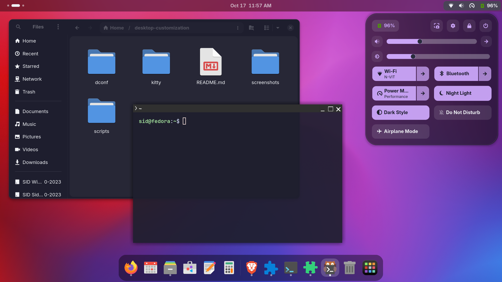
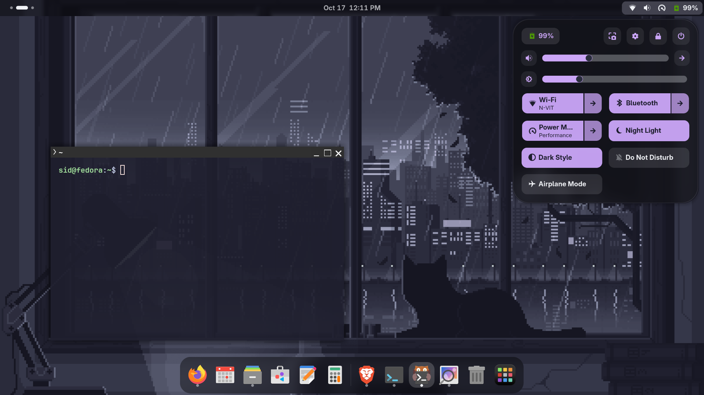
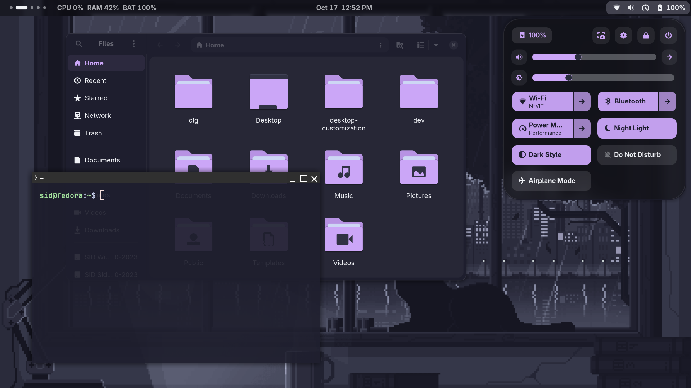
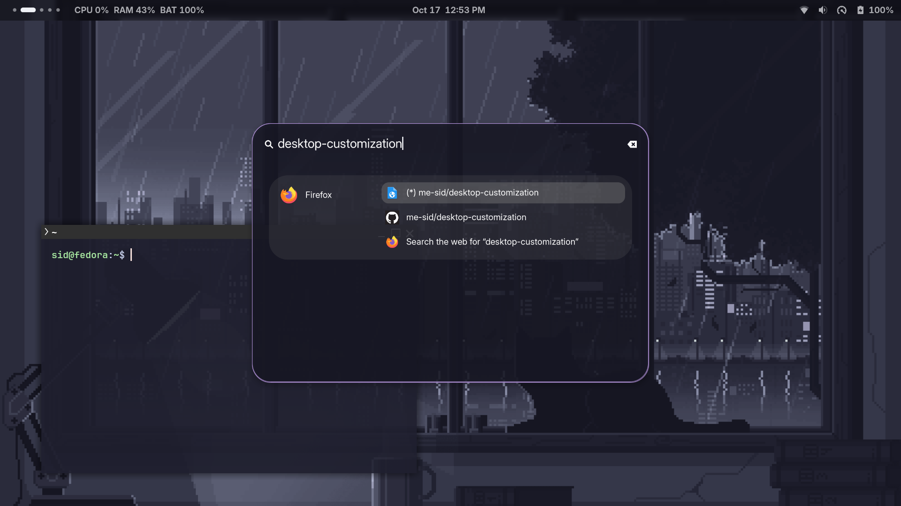

# Desktop Customization on Fedora GNOME

A consistent, keyboard-driven developer desktop on **Fedora GNOME 50**.
The terminal, launcher, top bar, windows, icons and cursor all share one palette, and everything is stored in this repo so it can be rebuilt with one command.

## Screenshots

## What's in this setup

| Area | Tool |
|---|---|
| Distro / desktop | Fedora, GNOME 50 (Wayland) |
| Terminal | kitty + JetBrainsMono Nerd Font |
| Window / GTK theme | Catppuccin-Mauve-Dark (GTK3, GTK4/libadwaita, GNOME Shell) |
| Icons / cursor | Papirus-Dark with Catppuccin mauve folders, Catppuccin Mocha Mauve cursor |
| Top bar | Just Perfection, Blur My Shell, User Themes |
| Launcher | Search Pulse (Super + D), styled in Mocha colors |
| Window tiling | Tiling Shell |
| Stats in the bar | `scripts/stats.5s.sh`, shown with Executor |
| Dotfile linking | GNU Stow |

## Palette (Catppuccin Mocha)

| Role | Color |
|---|---|
| Base | `#1e1e2e` |
| Surface | `#313244` |
| Text | `#cdd6f4` |
| Accent (mauve) | `#cba6f7` |

## Shortcuts

| Keys | Action |
|---|---|
| Super + Enter | Open kitty |
| Super + D | Open the launcher |
| Super + 1..5 | Go to workspace 1..5 |
| Super + Shift + 1..5 | Move the focused window to workspace 1..5 |
| Super + Q | Close window |
| Super + Shift + S | Screenshot |
| Super + A | App grid |

Workspaces are fixed at 5. Window tiling shortcuts are set in the Tiling Shell settings.

## Stats script

`scripts/stats.5s.sh` prints CPU and RAM usage on its first line. The Executor extension runs it and shows that line in the top bar, refreshing every 5 seconds (the `5s` in the file name is the interval).
Run directly, it also prints uptime, battery status and load average.

To set it up by hand: in Executor's settings, add a command with a 5 second interval:

    bash -c '~/desktop-customization/scripts/stats.5s.sh | head -1'

The Executor settings are saved in `dconf/extensions.dconf`, so `install.sh` restores them.

## Install

    git clone https://github.com/me-sid/desktop-customization.git
    cd desktop-customization
    ./install.sh

`install.sh` installs the packages, Nerd Font, cursor, GTK theme, folder colors and launcher extension, links the kitty config with GNU Stow and loads the saved GNOME settings.

Steps it cannot do for you:

1. When the GTK theme installer asks whether to apply the theme, choose **No**. The script links the theme itself.
2. Install these from Extension Manager: User Themes, Just Perfection, Blur My Shell, Executor, Tiling Shell.
3. Log out and back in, then enable all the extensions.
4. Set a wallpaper yourself. Put an image in `wallpaper/` and run:

        gsettings set org.gnome.desktop.background picture-uri "file://$PWD/wallpaper/YOUR_IMAGE.png"
        gsettings set org.gnome.desktop.background picture-uri-dark "file://$PWD/wallpaper/YOUR_IMAGE.png"

Note: the install script has not been tested on a clean install yet.

## Repo layout

- `kitty/`: kitty config and Catppuccin theme (symlinked into `~/.config` with stow)
- `scripts/`: custom scripts
- `dconf/`: exported GNOME settings (theme, shortcuts, extension settings, Executor, workspace rules)
- `wallpaper/`: wallpaper image
- `screenshots/`: screenshots used in this README
- `install.sh`: one-command setup

## Updating the saved settings

After changing something in GNOME, re-export it so the repo stays current:

    dconf dump /org/gnome/desktop/interface/ > dconf/interface.dconf
    dconf dump /org/gnome/desktop/wm/keybindings/ > dconf/wm-keybindings.dconf
    dconf dump /org/gnome/shell/keybindings/ > dconf/shell-keybindings.dconf
    dconf dump /org/gnome/settings-daemon/plugins/media-keys/ > dconf/keybindings.dconf
    dconf dump /org/gnome/shell/extensions/ > dconf/extensions.dconf
    dconf dump /org/gnome/shell/ > dconf/shell.dconf

## Bonus features

- One-command install (`install.sh`)
- Extended kitty setup: powerline tabs, splits, themed cursor and tab bar

## Credits

- [Catppuccin](https://github.com/catppuccin): palette, cursors and Papirus folder colors
- [Fausto-Korpsvart Catppuccin GTK theme](https://github.com/Fausto-Korpsvart/Catppuccin-GTK-Theme)
- [Search Pulse](https://github.com/rezkycodes/search-pulse) launcher extension
